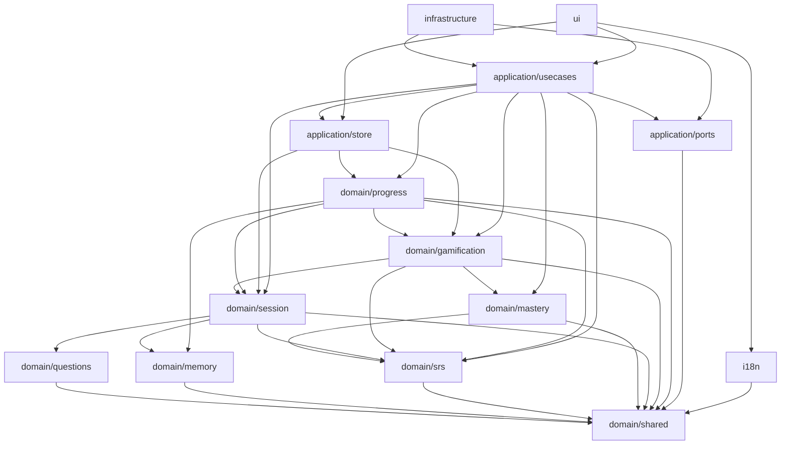

# Architecture technique — Aron 36

> État : Phase 2 terminée. Toute affirmation de ce document doit être
> vérifiable ; la traçabilité est générée.
>
> Statut : **gelée par la Phase 1**. Ce document est la référence des Phases 2 à 5.
> Il décrit les frontières, les contrats de données et les décisions techniques ;
> il ne contient aucune implémentation métier.
>
> Documents liés : [`PLAN.md`](./PLAN.md) (objectif et mécanismes d'apprentissage),
> [`adr/`](./adr/) (décisions et alternatives rejetées).

## 1. Vue d'ensemble

Aron 36 est une **application web statique, hors ligne-first, sans backend**.
Elle entraîne la restitution par cœur des 36 questions d'Aron et al. (1997) :
rappel actif, répétition espacée, entrelacement, imagerie et films mentaux, le
tout enveloppé dans une progression gamifiée. La progression vit dans
`localStorage`, sous un schéma versionné et exportable.

### Principe directeur : le domaine est pur, l'I/O est aux frontières

```
┌──────────────────────────────────────────────────────────────┐
│ UI (React)                                                   │
│  écrans, design system, accessibilité                        │
└───────────────┬──────────────────────────────────────────────┘
                │ lit AppState, dispatch AppAction, appelle UseCases
┌───────────────▼──────────────────────────────────────────────┐
│ Application                                                  │
│  store, cas d'usage, orchestration                           │
│  ├── ports : ClockPort, RandomPort, StoragePort, SpeechPort  │
│  └── dépend de : domain (types + fonctions pures)            │
└───────────────┬──────────────────────────────────────────────┘
                │
┌───────────────▼──────────────────────────────────────────────┐
│ Domain (pur)                                                 │
│  questions · memory · srs · mastery · session · gamification │
│  progress · shared                                           │
│  AUCUN React, DOM, Date, Math.random, localStorage, fetch    │
└──────────────────────────────────────────────────────────────┘
                ▲
                │ implémente les ports
┌───────────────┴──────────────────────────────────────────────┐
│ Infrastructure                                               │
│  localStorage · horloge système · aléa seedé · Web Speech    │
└──────────────────────────────────────────────────────────────┘
```

Règles non négociables :

1. **Le domaine ne dépend de rien** (hors `domain/shared`). Pas de React, pas de
   DOM, pas de `Date.now()`, pas de `Math.random()`, pas de `localStorage`.
2. **Toute I/O passe par un port** déclaré dans `src/application/ports/`.
3. **Tout est déterministe en test** : `ClockPort` et `RandomPort` injectés.
4. **Une seule source de vérité persistée** : `PersistedProgress`, versionnée.
5. **L'UI ne décide de rien** : elle affiche l'état et déclenche des cas d'usage.
6. **Aucun texte visible codé en dur** : catalogues i18n + `LocalizedText`.

Ces règles sont rendues exécutables par ESLint (voir § 3.4) et par la CI.

## 2. Arborescence cible de `src/`

```
src/
├── main.tsx                     # point d'entrée React (Phase 4)
├── App.tsx                      # racine applicative (placeholder en Phase 1)
├── styles/
│   ├── tokens.css               # design tokens (couleurs, espacements, mouvement)
│   └── global.css               # reset + styles de base + focus visible
├── domain/                      # CŒUR PUR — aucune I/O, aucun framework
│   ├── shared/
│   │   ├── types.ts             # EpochMs, DayKey, DrillDirection, ReviewGrade…
│   │   └── index.ts
│   ├── questions/
│   │   ├── types.ts             # QuestionItem, Act, QuestionCatalog, DatasetMetadata
│   │   ├── catalog.ts           # (Phase 2) dataset des 36 questions + validation
│   │   ├── catalog.test.ts      # (Phase 2) invariants du contenu
│   │   └── index.ts
│   ├── memory/
│   │   ├── types.ts             # MemoryFilm, FilmScene, PersonalHook, HookLibrary
│   │   ├── films.ts             # (Phase 2) 3 films mentaux dérivés du catalogue
│   │   ├── hooks.ts             # (Phase 2) règles des accroches personnelles
│   │   ├── film.test.ts         # (Phase 2)
│   │   └── index.ts
│   ├── srs/
│   │   ├── types.ts             # CardState, Scheduler, ScheduledReview, ReviewLog
│   │   ├── scheduler.ts         # (Phase 2) FSRS-lite déterministe
│   │   ├── scheduler.test.ts    # (Phase 2) monotonie, intervalles, notes
│   │   └── index.ts
│   ├── mastery/
│   │   ├── types.ts             # MasteryCriteria, ActMastery, MasterySnapshot
│   │   ├── evaluator.ts         # (Phase 2) maîtrise par question et par acte
│   │   ├── evaluator.test.ts    # (Phase 2) déblocage L14
│   │   └── index.ts
│   ├── session/
│   │   ├── types.ts             # SessionPlan, SessionItem, SessionEngine, SessionLog
│   │   ├── builder.ts           # (Phase 2) sélection, directions, entrelacement
│   │   ├── engine.ts            # (Phase 2) machine à états, indices, feedback
│   │   ├── hints.ts             # (Phase 2) fabrique d'indices progressifs
│   │   ├── builder.test.ts      # (Phase 2)
│   │   ├── engine.test.ts       # (Phase 2)
│   │   ├── directions.test.ts   # (Phase 2)
│   │   └── index.ts
│   ├── gamification/
│   │   ├── types.ts             # XP, niveaux, séries, badges, quêtes, collection
│   │   ├── xp.ts                # (Phase 2) barème et anti-farm
│   │   ├── level.ts             # (Phase 2) courbe et titres
│   │   ├── streak.ts            # (Phase 2) série + gel
│   │   ├── badges.ts            # (Phase 2) catalogue et évaluateur
│   │   ├── quests.ts            # (Phase 2) tirage quotidien déterministe
│   │   ├── collection.ts        # (Phase 2) obtention des 36 cartes
│   │   ├── metrics.ts           # (Phase 2) métriques dérivées des journaux
│   │   ├── xp.test.ts           # (Phase 2)
│   │   ├── badges.test.ts       # (Phase 2)
│   │   ├── quests.test.ts       # (Phase 2)
│   │   ├── metrics.test.ts      # (Phase 2)
│   │   └── index.ts
│   └── progress/
│       ├── types.ts             # PersistedProgress, Migration, ProgressCodec
│       ├── codec.ts             # (Phase 3) encode/decode/validate/migrate
│       ├── migrations.ts        # (Phase 3) registre vN → vN+1
│       ├── defaults.ts          # (Phase 3) état initial d'un nouveau joueur
│       ├── codec.test.ts        # (Phase 3)
│       ├── migrations.test.ts   # (Phase 3)
│       └── index.ts
├── application/                 # ORCHESTRATION — aucun rendu
│   ├── ports/
│   │   ├── ClockPort.ts
│   │   ├── RandomPort.ts
│   │   ├── StoragePort.ts
│   │   ├── SpeechPort.ts
│   │   └── index.ts
│   ├── store/
│   │   ├── types.ts             # AppState, UiState, AppAction, AppStore
│   │   ├── store.ts             # (Phase 3) réducteur pur + abonnements
│   │   ├── store.test.ts        # (Phase 3)
│   │   └── index.ts
│   └── usecases/
│       ├── types.ts             # AppServices, UseCases, entrées/sorties
│       ├── startSession.ts      # (Phase 3)
│       ├── submitAnswer.ts      # (Phase 3)
│       ├── finishSession.ts     # (Phase 3)
│       ├── saveHook.ts          # (Phase 3)
│       ├── progressIO.ts        # (Phase 3) import/export/reset
│       ├── evaluateMastery.ts   # (Phase 3)
│       ├── *.test.ts            # (Phase 3)
│       └── index.ts
├── infrastructure/              # ADAPTATEURS — aucun rendu
│   ├── clock/SystemClock.ts     # (Phase 3) Date.now + Intl pour DayKey
│   ├── random/SeededRandom.ts   # (Phase 3) PRNG seedé (ex. mulberry32)
│   ├── storage/LocalStorageAdapter.ts # (Phase 3) localStorage + quota
│   ├── storage/MemoryStorage.ts # (Phase 3) faux stockage pour les tests
│   ├── speech/WebSpeechAdapter.ts     # (Phase 3) SpeechSynthesis
│   └── index.ts                 # (Phase 3) composition root
├── ui/                          # REACT — Phase 4
│   ├── app/                     # providers, routeur d'écrans, layout
│   ├── screens/                 # Home, Train, Review, Collection, Stats, Settings
│   ├── components/              # DrillCard, GradeBar, HintLadder, XpBar…
│   ├── hooks/                   # useStore, useSession, useSpeech…
│   ├── a11y/                    # focus trap, live region, skip link
│   └── styles/                  # CSS Modules par composant
├── i18n/
│   ├── types.ts                 # MessageCatalog, Translator, I18n
│   ├── index.ts                 # (Phase 3) sélection et repli
│   └── locales/
│       ├── fr.ts                # (Phase 3) catalogue complet
│       ├── en.ts                # (Phase 3) catalogue secondaire
│       └── README.md
└── test/
    ├── setup.ts                 # jest-dom + cleanup
    └── fixtures/                # (Phase 2+) horloge, aléa, catalogue de test
```

## 3. Modules et frontières

### 3.1 Domaine

| Module                | Responsabilité                                                               | Importe                                              | Expose                                                                                                           |
| --------------------- | ---------------------------------------------------------------------------- | ---------------------------------------------------- | ---------------------------------------------------------------------------------------------------------------- |
| `domain/shared`       | Vocabulaire commun : unités, ids, directions, notes, constantes du protocole | rien                                                 | types et constantes                                                                                              |
| `domain/questions`    | Contenu et invariants des 36 questions, actes, métadonnées de dataset        | `shared`, `memory` (type `MemoryFilm`)               | `QuestionItem`, `QuestionCatalog`, `QuestionDataset`                                                             |
| `domain/memory`       | Films mentaux, scènes chaînées, accroches personnelles                       | `shared`                                             | `MemoryFilm`, `PersonalHook`, `HookLibrary`                                                                      |
| `domain/srs`          | État des cartes, ordonnanceur, journal de révision                           | `shared`                                             | `CardState`, `Scheduler`, `ScheduledReview`, `ReviewLog`                                                         |
| `domain/mastery`      | Maîtrise par question/direction/acte, déblocage                              | `shared`, `srs`                                      | `MasteryEvaluator`, `MasterySnapshot`                                                                            |
| `domain/session`      | Construction de plan, directions, indices, machine à états                   | `shared`, `srs`, `questions`, `memory`               | `SessionBuilder`, `SessionEngine`, `SessionPlan`                                                                 |
| `domain/gamification` | XP, niveaux, séries, badges, quêtes, collection, métriques                   | `shared`, `srs`, `session`, `mastery`                | `XpCalculator`, `LevelCalculator`, `StreakUpdater`, `QuestGenerator`, `CollectionEvaluator`, `MetricsCalculator` |
| `domain/progress`     | Agrégat persisté, version de schéma, codec, migrations                       | `shared`, `memory`, `srs`, `session`, `gamification` | `PersistedProgress`, `ProgressCodec`, `Migration`                                                                |

Le domaine est **synchrone** : aucun `Promise`, aucun timer, aucun effet de bord.
Les fonctions de Phase 2 sont pures : mêmes entrées ⇒ mêmes sorties.

**Pourquoi `gamification` dépend de `mastery`.** `PlayerMetrics` expose
`masteredQuestions` / `masteredActs`, et la condition de badge `act-mastered`
exige les critères de maîtrise. Interdire cette arête rendait ces valeurs
incalculables et dupliquait le seuil « maîtrisé » en deux endroits. Cycle
impossible : `mastery → srs → shared`, et aucun module ne dépend en retour de
`gamification` (les journaux ne portent qu'un `xpAwarded: number`).

**Unités numériques (ADR 0009).** `EpochMs`, `DurationMs`, `Days`, `Minutes`,
`Ratio` et `Percentage` ne sont pas distingués par le système de types. En
contrepartie, `NUMERIC_BOUNDS` (`domain/shared/types.ts`) fixe à l'exécution les
bornes de chaque champ borné, et **tout décodage d'une donnée non fiable**
(stockage, import, saisie) doit l'appliquer. Test de référence :
`contracts.test.ts › "fournit des bornes d'exécution pour les champs numériques"`.

### 3.2 Application

| Module                 | Responsabilité                                       | Importe        | Expose                                                           |
| ---------------------- | ---------------------------------------------------- | -------------- | ---------------------------------------------------------------- |
| `application/ports`    | Contrats d'I/O (temps, aléa, stockage, voix, ids)    | `shared`       | `ClockPort`, `RandomPort`, `StoragePort`, `SpeechPort`, `IdPort` |
| `application/store`    | État racine, actions, abonnements                    | domaine, ports | `AppState`, `AppAction`, `AppStore`                              |
| `application/usecases` | Orchestration : sélection, notation, XP, persistance | domaine, ports | `AppServices`, `UseCases`, entrées/sorties                       |

Les cas d'usage sont l'**unique** endroit où l'on combine domaine + ports. Ils
renvoient des résultats explicites et ne lèvent pas d'exception d'I/O.

**Propriété de la progression (revue Phase 3).** `PersistedProgress` a **un seul
propriétaire : les cas d'usage**. Le store ne la calcule jamais, il la **reçoit** :
les actions `session/answered` et `session/completed` portent l'état complet
produit — et déjà persisté — par le cas d'usage, et le réducteur se contente de
l'installer (`{ ...state, progress: action.progress }`), plus la session et le
feedback pour l'affichage. Le réducteur n'y dérive rien : ni carte SRS, ni
`ReviewLog`, ni XP, ni quête, ni série, ni badge, ni collection. Cette décision
supprime la divergence store/persisté observée en revue (série, badges, quêtes,
collection restés à zéro côté store) et tout risque de double comptage avec
`progress/replaced`, qui remplace un état absolu et reste idempotent.

### 3.3 Infrastructure et UI

| Module              | Responsabilité                                                                                                    | Importe                                                | Expose                                 |
| ------------------- | ----------------------------------------------------------------------------------------------------------------- | ------------------------------------------------------ | -------------------------------------- |
| `infrastructure/**` | Adaptateurs concrets : `SystemClock`, `SeededRandom`, `LocalStorageAdapter`, `WebSpeechAdapter`, composition root | `application/*`, `domain/*`                            | instances de ports, `createServices()` |
| `ui/**`             | React 19, écrans, design system, accessibilité                                                                    | `application/*`, `domain/*` (types/constantes), `i18n` | composants et hooks                    |
| `i18n/**`           | Catalogues de messages, traduction, repli                                                                         | `shared`                                               | `I18n`, `Translator`, catalogues       |

L'UI **n'importe jamais** `@/infrastructure/*` : elle reçoit ses dépendances par
props ou contexte. L'infrastructure **n'importe jamais** `@/ui/*`.

### 3.4 Diagramme de dépendances



Aucune flèche ne remonte vers `ui` ni vers `infrastructure`. `domain/shared` n'a
aucune arête sortante.

**Règles ESLint (extrait de `eslint.config.js`)** :

- `src/domain/**` interdit `react`, `react-dom`, `@/ui/*`, `@/infrastructure/*`,
  `@/application/*`, `@/i18n/*`, `*.css`, `node:*` ;
- globals interdits dans le domaine : `window`, `document`, `navigator`,
  `localStorage`, `sessionStorage`, `fetch`, `crypto`, `performance`, `Date`,
  `setTimeout`, `setInterval`, `requestAnimationFrame` ;
- `Math.random` et `Date.now` interdits dans le domaine ;
- `application/**` interdit React et `@/infrastructure/*` ;
- `infrastructure/**` interdit `@/ui/*` et `react-dom/client` ;
- `ui/**` interdit `@/infrastructure/*`.

## 4. Modèle de données

Toutes les entités sont **immuables** (`readonly`) et sérialisables en JSON.
Les dates sont des entiers `EpochMs` (ms UTC) ; les jours civils des chaînes
`DayKey` (`YYYY-MM-DD`, fuseau local via `ClockPort`). Aucun `Date` dans le
domaine.

### 4.1 Contenu

| Entité            | Champs                                                                                   | Invariants                                                                                                        |
| ----------------- | ---------------------------------------------------------------------------------------- | ----------------------------------------------------------------------------------------------------------------- |
| `QuestionItem`    | `id`, `actId`, `order`, `positionInAct`, `keyword`, `prompt`, `mentalImage`, `themeTags` | 36 items, ids 1..36 ; `actId = ⌊(order-1)/12⌋+1` ; `positionInAct = ((order-1) mod 12)+1` ; textes `fr` non vides |
| `Act`             | `id`, `order`, `title`, `film`                                                           | 3 actes ; 12 questions ; un film de 12 scènes                                                                     |
| `QuestionCatalog` | `questions`, `acts`, `byId`, `byKeyword`                                                 | index complets, aucune entrée orpheline                                                                           |
| `DatasetMetadata` | `sourceCitation`, `frenchTranslationVerified`, `contentVersion`, `frenchCompleteness`    | `frenchTranslationVerified` reste `false` tant que la vérification humaine contre l'anglais n'est pas faite       |
| `MemoryFilm`      | `actId`, `title`, `pitch`, `scenes`                                                      | 12 scènes ordonnées 1..12, `transitionToNext` non nul sauf la dernière                                            |
| `PersonalHook`    | `questionId`, `kind`, `text`, `createdAt`, `updatedAt`                                   | 1..280 caractères ; au plus une accroche par question                                                             |

### 4.2 Apprentissage

| Entité            | Champs                                                                                                                                                                                         | Invariants                                                                                                                                              |
| ----------------- | ---------------------------------------------------------------------------------------------------------------------------------------------------------------------------------------------- | ------------------------------------------------------------------------------------------------------------------------------------------------------- |
| `CardState`       | `questionId`, `phase`, `dueAt`, `intervalDays`, `stabilityDays`, `learningStep`, `difficulty`, `reps`, `lapses`, `consecutiveSuccesses`, `lastReviewedAt`, `lastGrade`                         | `difficulty ∈ [1,10]` ; `phase='new'` ⇒ `reps=0`, `lastReviewedAt=null` ; `lastGrade≠null` ⇔ `lastReviewedAt≠null` ; `dueAt` seule source de vérité     |
| `ReviewLog`       | `id`, `sessionId`, `questionId`, `direction`, `exerciseKind`, `grade`, `reviewedAt`, `previousDueAt`, `nextDueAt`, `intervalDays`, `elapsedDays`, `responseTimeMs`, `hintsUsed`, `confidence`  | append-only ; `previousDueAt=null` pour une première exposition ; une ligne par item gradué                                                             |
| `ScheduledReview` | `previousCard`, `nextCard`, `elapsedDays`, `retrievabilityBefore`, `isLapse`, `intervalDeltaDays`                                                                                              | résultat pur, avant journalisation                                                                                                                      |
| `SessionPlan`     | `id`, `mode`, `seed`, `createdAt`, `config`, `items`, `interleaving`, `dueQuestionIds`                                                                                                         | items non vides ; directions couvertes ; graine enregistrée                                                                                             |
| `SessionItem`     | `id`, `questionId`, `actId`, `direction`, `cue`, `expectedAnswer`, `mentalImage`, `hints`, `isPretest`, et `options`+`correctOptionId` si discrimination                                       | `hints` ordonnés faible→fort, vide si et seulement si `hintPolicy = disabled` ; discrimination ≤ 20 % et explicitement étiquetée, jamais en mode examen |
| `SessionState`    | `plan`, `phase`, `currentIndex`, `answers`, `revealedHints`, `confidence`, `startedAt`, `completedAt`                                                                                          | transitions `asking → revealed → completed` ; un seul item courant                                                                                      |
| `SessionAnswer`   | `itemId`, `questionId`, `direction`, `exerciseKind`, `grade`, `confidence`, `responseTimeMs`, `hintsUsed`, `channel`, `answeredAt`, `isCorrect`                                                | `hintsUsed ≤ hints.length` ; `channel ∈ {written, spoken, self-declared}`                                                                               |
| `SessionLog`      | `sessionId`, `mode`, `planSeed`, `startedAt`, `endedAt`, `durationMs`, `window`, `itemCount`, `productionCount`, `discriminationCount`, `spokenCount`, `correctCount`, `accuracy`, `xpAwarded` | `accuracy ∈ [0,1]` ; lignes tronquées à 500                                                                                                             |

### 4.3 Progression

| Entité              | Champs                                                                                            | Invariants                                                               |
| ------------------- | ------------------------------------------------------------------------------------------------- | ------------------------------------------------------------------------ |
| `PlayerState`       | `profile`, `totalXp`, `streak`, `badges`, `questBoard`, `collection`, `settings`                  | agrégat du joueur ; aucune donnée serveur                                |
| `StreakState`       | `current`, `longest`, `lastActiveDay`, `freezes`, `frozenDays`                                    | `0 ≤ current ≤ longest` ; `freezes ≤ 2` ; jamais de perte de progression |
| `BadgeState`        | `badgeId`, `unlockedAt`, `progress`, `target`                                                     | `0 ≤ progress ≤ target` ; déblocage irréversible                         |
| `QuestBoard`        | `dayKey`, `seed`, `quests`                                                                        | exactement 3 quêtes, stables pour un même `dayKey`                       |
| `CollectionState`   | `entries[]` (`questionId`, `rarity`, `obtainedAt`, `masteryTier`)                                 | au plus 36 entrées, une par question ; jamais retirée                    |
| `PersistedProgress` | `schemaVersion`, `appVersion`, `savedAt`, `player`, `cards`, `hooks`, `reviewLogs`, `sessionLogs` | racine unique persistée ; voir § 5                                       |

### 4.4 Agrégat et dérivation

`PersistedProgress` est l'**unique agrégat racine**. Les vues
(`PlayerProgressView`, `MasterySnapshot`, `SessionSummary`, `PlayerMetrics`) sont
**dérivées** à la demande et ne sont jamais persistées. Toute donnée dérivable
est recalculée depuis `cards`, `reviewLogs`, `sessionLogs` et `player` : cela
évite les états incohérents et permet de rejouer l'historique.

## 5. Persistance versionnée

### 5.1 Clé et enveloppe

- clé unique : `aron36.progress` (`STORAGE_KEY`) ;
- sauvegardes de corruption : `aron36.progress.corrupt.<epochMs>` ;
- clés du prototype v0 lues une seule fois : `aron36.srs`, `aron36.plan` ;
- format interne : JSON de `PersistedProgress` ;
- format d'export : `ExportEnvelope` avec `format: "aron36-progress"` et
  `formatVersion: 1`.

```jsonc
{
  "schemaVersion": 1,
  "appVersion": "0.x.y",
  "savedAt": 1762700000000,
  "player": { "profile": {}, "totalXp": 0, "streak": {}, "badges": [], "...": "..." },
  "cards": { "1": { "questionId": 1, "phase": "new", "...": "..." } },
  "hooks": { "hooks": [], "updatedAt": 1762700000000 },
  "reviewLogs": [],
  "sessionLogs": [],
}
```

Les clés de `cards` sont des entiers sérialisés en chaîne décimale. À la
validation, la clé doit être un entier 1..36 et coïncider avec
`card.questionId`.

### 5.2 Cycle de vie

1. **Démarrage** — `StoragePort.read(STORAGE_KEY)`.
   - absent → état initial (`defaults.ts`), `status: "empty"`.
   - présent → `ProgressCodec.decode(raw)`.
2. **Décodage** — `JSON.parse`, contrôle de `schemaVersion`, application des
   migrations `v → v+1` jusqu'à `SCHEMA_VERSION`, validation structurelle et
   validation des invariants.
3. **Hydratation** — le store passe `ready: true` ; aucun écran de jeu n'est
   rendu avant.
4. **Écriture** — après chaque action qui modifie la progression, debounce de
   500 ms, écriture sérialisée, `savedAt = clock.now()`, `appVersion` injectée
   par la composition root.
5. **Corruption** — la donnée brute est recopiée sous la clé de sauvegarde, le
   résultat est `{ status: "corrupt", error, backupKey }`. **Aucun écrasement
   silencieux.** L'UI propose : télécharger la sauvegarde brute, réessayer, ou
   réinitialiser avec double confirmation.

### 5.3 Migrations

```ts
interface Migration {
  fromVersion: number;
  toVersion: number; // toujours fromVersion + 1
  description: string;
  migrate(input: unknown): unknown;
}
```

- Une migration est **pure**, ne lit jamais le stockage et ne dépend pas de
  l'horloge.
- Règle exacte des versions : `schemaVersion < MIN_SUPPORTED_SCHEMA_VERSION` ⇒
  `unsupported-version` ; un trou dans la chaîne de migrations ⇒
  `missing-migration` ; `schemaVersion > MAX_SUPPORTED_SCHEMA_VERSION` ⇒ statut
  **`future-version`**, en **lecture seule** (aucune migration, aucune écriture,
  aucune réinitialisation : l'UI invite à mettre à jour l'application). La table
  `PROGRESS_RECOVERY_ACTIONS` fixe l'action UI de chaque code d'erreur, et
  `contracts.test.ts › "traite une version future comme non destructive"` la vérifie.
- Toute migration est couverte par un test avec une fixture JSON figée de la
  version source.
- v0 → v1 (Phase 3) : les boîtes de Leitner (`box` 1..5) sont converties en
  intervalles `[1, 2, 4, 8, 16]` jours, `phase = "review"`, `dueAt` conservé ;
  les cases du plan 7 jours ne sont pas importées (hors périmètre v1).
- Une migration ratée n'écrit rien : l'état précédent reste intact.

### 5.4 Import / export

- **Export** : `ProgressCodec.toExport()` → fichier
  `aron36-progression-YYYY-MM-DD.json`.
- **Import** : lecture du fichier, contrôle du `format`, migration, validation
  complète, puis **remplacement atomique** de l'état en mémoire et écriture.
  Un import invalide ne modifie rien et renvoie `{ ok: false, error }`.
- Limites de rétention : 5 000 `ReviewLog`, 500 `SessionLog` (les plus récents).
- Quota dépassé : `StoragePort.write` renvoie `quota-exceeded` ; l'UI affiche un
  avertissement non bloquant et propose l'export ; la session en cours continue
  en mémoire.

### 5.5 Limite connue : multi-onglets

**Comportement actuel.** Deux onglets ouverts simultanément tiennent chacun leur
copie de `PersistedProgress` en mémoire et écrivent la clé unique
`aron36.progress` en entier à chaque mutation. Il n'y a ni verrou, ni fusion :
**le dernier écrivain gagne**, et la progression écrite par l'autre onglet est
silencieusement perdue. Preuve : 2 réponses dans l'onglet 1 puis 2 accroches
dans l'onglet 2 ne laissent qu'un seul `ReviewLog` conservé et l'XP de l'onglet 2
— les écritures de l'onglet 1 sont écrasées.

**Risque.** Perte d'une réponse (et d'une partie de la progression) sans message
pour l'utilisateur, dans un cas d'usage réaliste : ouvrir un second onglet pour
comparer un écran pendant une session.

**Hors périmètre v1.** Aucun correctif n'est livré ici. Pistes retenues pour la
suite : relire la clé avant chaque écriture et réconcilier (fusion par
identifiant, ou refus averti si la version lue diffère), et/ou écouter
l'évènement `storage` pour réhydrater l'onglet devenu obsolète ou avertir
l'utilisateur. Toute solution devra rester **sans backend** et préserver la
décision « la progression a un seul propriétaire : les cas d'usage ».

## 6. Contrat d'ordonnancement SRS

### 6.1 Algorithme retenu : FSRS-lite

Deux composantes par carte, à ne jamais confondre :

- **stabilité** `S` (`stabilityDays`) : mémoire estimée, en jours ;
- **intervalle** `I` (`intervalDays`) : commande d'ordonnancement, en jours ;
- **difficulté** `D` (`difficulty`) : intrinsèque à l'item, bornée 1..10.

`S` mesure une trace mnésique, `I` désigne la prochaine échéance. Pendant
`learning` / `relearning`, `I` n'est qu'un palier de quelques minutes et n'a
aucune signification mnésique : c'est `S` qui porte la mémoire.

La rétention estimée au moment de la révision se calcule donc sur la
**stabilité** :

```
R = targetRetention ^ (elapsedDays / max(S, 1e-6))
```

bornée à `[0, 1]`, avec `targetRetention = 0.9`. Pour une carte jamais révisée
(`lastReviewedAt = null`), `R = 0` par convention : sans trace, aucune rétention
n'est démontrée.

La difficulté est mise à jour avec un rappel vers la moyenne :

```
D' = clamp((1 − λ) × (D + δ(grade)) + λ × 5, 1, 10)     λ = 0.1
δ(again) = +1.00   δ(hard) = +0.15   δ(good) = −0.15   δ(easy) = −0.50
```

### 6.2 Transitions

**Carte neuve ou en apprentissage** (`learningStepsMinutes = [1, 10]`) :

| Note    | Effet                                                                           |
| ------- | ------------------------------------------------------------------------------- |
| `again` | palier 0 ; échéance `now + 1 min` ; `lapses` inchangé en phase `new`            |
| `hard`  | même palier ; échéance `now + max(5 min, palier courant)`                       |
| `good`  | palier suivant ; dernier palier → graduation à `graduatingIntervalDays` = `1 j` |
| `easy`  | graduation immédiate à `easyIntervalDays` = `4 j`                               |

En phase `learning`, `hard` est borné par le palier courant (`max` de 5 min et du
palier) : il ne saute ni ne rétrograde de palier.

**Carte en révision** (`phase = "review"`) — chaque facteur de croissance est
multiplié par `m(D) ∈ [0,5 ; 1,5]`, interpolation linéaire de `1,5` (`D = 1`,
carte facile) à `0,5` (`D = 10`, carte difficile), valant `1` pour `D = 5,5` :

```
hard  : I' = clamp(round(I × 1,2 × m(D)),                  I + 1, min(180, plafond hard))
good  : I' = clamp(round(I × (1,8 + 0,7 × (1−R)) × m(D)),  I + 1, 180)
easy  : I' = clamp(round(I × (2,5 + 0,7 × (1−R)) × m(D)),  I + 2, 180)
again : I' = 10 minutes, phase = "relearning", S' = max(0,5 ; S × 0,35), lapses + 1
```

Le plafond propre à `hard` vaut `maxIntervalDays × hardIntervalCeilingRatio`
(50 % par défaut) : `hard` seul ne peut pas conduire une carte à
`maxIntervalDays` par répétition. `dueAt = now + I' × DAY_MS` ; plus la révision
est en retard (`R` faible), plus l'intervalle suivant croît : c'est la difficulté
désirable (L9).

**Réapprentissage** : `good` sur le dernier palier remet la carte en `review` à
`relearningGraduatingIntervalDays` = **1 j** ; `easy` fait de même à **2 j**
(`relearningGraduatingIntervalDays × 2`). Ces intervalles sont **fixés par la
configuration et indépendants de la stabilité héritée** : après une chute, aucune
rétention longue n'est prouvée, la carte doit regagner ses intervalles par des
réussites espacées. `again` reste sur le palier de réapprentissage.

### 6.3 Monotonie et garanties

Contrat testable, pour toute carte, y compris importée ou hors invariants :

1. `grade ∈ {hard, good, easy}` ⇒ `next.dueAt > previous.dueAt`, **toujours**
   (y compris à saturation et sur un état importé) ;
2. `grade ∈ {hard, good, easy}` ⇒
   `next.intervalDays ≥ min(previous.intervalDays, maxIntervalDays)` : le plafond
   prime sur un intervalle d'entrée hors bornes ;
3. `previewIntervals` est croissant : `again ≤ hard ≤ good ≤ easy` en jours ;
4. `I' ≤ maxIntervalDays` ;
5. `difficulty` reste dans `[1, 10]` ;
6. aucune lecture d'horloge interne : `now` est un paramètre ;
7. aucun aléa : pas de « fuzz » en v1 (`RandomPort` non injecté).

Une bonne réponse ne peut donc **jamais** avancer l'échéance à la baisse. Seul
`again` ramène la carte à quelques minutes, ce qui est le comportement attendu
d'un échec.

### 6.4 Critère « maîtrisé »

Une carte est maîtrisée si et seulement si :

```
phase = "review"
ET I ≥ minIntervalDays (21)
ET série de notes de qualité ≥ minConsecutiveSuccesses (2)
ET révisions de qualité ≥ minReps (3)
```

La **série** et le **nombre de révisions** portent sur des notes de **qualité**
(`good`/`easy`), recalculées depuis les `ReviewLog` (un `hard` ou un `again`
interrompt la série). `CardState.consecutiveSuccesses`, compteur de
l'ordonnanceur sur toute note réussie (`hard`, `good`, `easy`), **n'entre pas**
dans le critère de maîtrise.

Une question est maîtrisée si sa carte l'est **et** qu'elle a été produite avec
une précision ≥ 80 % dans au moins 3 directions distinctes (≥ 2 tentatives par
direction). Voir `DEFAULT_MASTERY_CRITERIA`.

### 6.5 Horloge et tests

`Scheduler.schedule(card, grade, now)` ne lit jamais l'horloge. Les tests
utilisent une horloge fixe (`FakeClock`) et des cartes construites à la main :

- `srs/scheduler.test.ts › "good augmente strictement l'échéance"` ;
- `srs/scheduler.test.ts › "une révision en retard croît plus qu'une révision à l'heure"` ;
- `srs/scheduler.test.ts › "again ramène en réapprentissage sans perte de carte"` ;
- `srs/scheduler.test.ts › "les intervalles prévisualisés sont ordonnés"`.

## 7. Contrat du moteur de session

### 7.1 Les cinq directions (L16)

| Direction             | Indice (`cue.kind`)             | Réponse attendue     |
| --------------------- | ------------------------------- | -------------------- |
| `order-to-question`   | `order` (acte + position 1..12) | texte de la question |
| `keyword-to-question` | `keyword`                       | texte de la question |
| `image-to-question`   | `image`                         | texte de la question |
| `number-to-question`  | `number` (1..36)                | texte de la question |
| `question-to-number`  | `question`                      | numéro 1..36         |

Le mapping n'est pas seulement documenté : `DrillCueMap` et
`DrillExpectedAnswerMap` sont indexés par `DrillDirection`, et `SessionItem` est
une **union indexée par la direction** (`ProductionSessionItem` /
`DiscriminationSessionItem`). Le compilateur refuse donc un couple
direction/indice incohérent — par exemple `image-to-question` avec un indice
`order` — ainsi qu'une réponse attendue incohérente. Preuve :
`contracts.test.ts › "garantit au niveau du type l'appariement direction → indice"`.

Le domaine n'a **aucune source de temps** : `SessionEngine.start(plan, now)` et
`SessionAnswerInput.now` reçoivent l'instant de la couche application, et
`SessionEngine.submitAnswer` renvoie un `SessionSubmissionResult` rejetable
(`wrong-phase`, `unknown-item`, `item-already-answered`, `session-completed`).
Les identifiants de session et de journal sont eux aussi fournis par
l'application (`IdPort`) : `SessionRequest.sessionId` est recopié tel quel dans
`SessionPlan.id`.

### 7.2 Construction d'un plan

`SessionBuilder.build(request, context)` applique, dans cet ordre :

1. **Filtres** — actes débloqués (`unlockedActIds`), actes/questions demandés,
   mode (`review` ⇒ cartes dues uniquement).
2. **Plafonds (L3)** — `maxItems` et `maxDurationMs` ; le nombre d'items est
   borné par `⌊maxDurationMs / coût estimé⌋` (30 s par production, 15 s par
   discrimination).
3. **Directions** — chaque item reçoit une direction parmi
   `config.directions` ; sur une session de N ≥ 5 items, les 5 directions sont
   représentées au moins une fois. Une question ne reçoit pas la même direction
   que lors de ses deux dernières révisions.
4. **Entrelacement (L4)** — les items sont ordonnés par échéance croissante puis
   distribués en round-robin sur les actes ; interdiction de 3 items consécutifs
   du même acte. Le descripteur `InterleavingDescriptor` enregistre les
   séquences pour les tests.
5. **Discrimination** — au plus 20 % des items, uniquement sur des cartes déjà
   rencontrées, jamais en première exposition ; 4 options, 3 leurres du même
   acte, ordre mélangé par `RandomPort` ; l'item porte
   `exerciseKind = "discrimination"` et l'UI doit l'étiqueter.
6. **Indices (L9)** — plan d'indices ordonné :
   `initials → first-words → keyword → mental-image → personal-hook → full-answer`
   (les niveaux indisponibles sont omis). `revealedHints = 0` au départ ;
   `HintPolicy` décide de la disponibilité, jamais de la révélation automatique
   en mode `on-demand`.
7. **Prétest (L18)** — en mode `discovery`, `isPretest = true` : l'apprenant
   devine avant la première révélation. La devinette n'est ni notée ni
   journalisée ; la tentative graduée qui suit est la première exposition SRS.

### 7.3 Ordre et reproductibilité

- Le tirage utilise **uniquement** `context` + un `RandomPort` recréé depuis
  `request.seed`.
- Mélange : Fisher–Yates, de `i = n−1` à `1`, avec `nextInt(0, i+1)`.
- Le plan enregistre `seed`, `createdAt`, `config`, `interleaving` : rejouer la
  graine reproduit exactement la session.
- Test : `session/builder.test.ts › "deux plans de même graine sont identiques"`.

### 7.4 Machine à états

```
asking ──revealNextHint()──► asking (revealedHints + 1)
asking ──revealAnswer()────► revealed
revealed ──submitAnswer()──► asking (item suivant) | completed
```

- `submitAnswer` n'est valide qu'en phase `revealed`.
- `SessionAnswer` est produit par le moteur ; `ReviewLog` et l'ordonnancement
  sont produits par le cas d'usage (le moteur ne connaît ni SRS ni XP).
- Le feedback (`AnswerFeedback`) contient toujours : réponse attendue, image
  mentale, `errorSignal` et une clé i18n d'explication (L13).
- `confidence` est requis avant révélation si `requiresConfidence` (L12) ; la
  valeur est conservée dans `SessionAnswer` et le `ReviewLog`.

### 7.5 Modes

| Mode         | Usage                         | Particularités                                            |
| ------------ | ----------------------------- | --------------------------------------------------------- |
| `discovery`  | Première exposition d'un acte | prétest, indices progressifs, acte bloqué si non débloqué |
| `learning`   | Apprentissage guidé d'un acte | ordre par acte, indices autorisés                         |
| `review`     | Révisions dues                | cartes dues uniquement, entrelacement maximal             |
| `recitation` | Récitation en ordre           | direction `order-to-question`, 12 ou 36 items             |
| `speed`      | Automaticité (L15)            | uniquement si l'acte est maîtrisé ; cible 4 s             |
| `grand-oral` | Examen final                  | 36 items, chronométré, sans indice, canal oral            |

## 8. Contrat de gamification

### 8.1 XP : uniquement la production réelle

```
base      = baseByDirection[direction]          // 10 à 14
note      = gradeMultiplier[grade]              // again 0, hard 0.5, good 1, easy 1.25
brut      = base × note
si discrimination : brut = brut × 0.5
brut     += firstExposureBonus (5, si première exposition réussie)
brut     += noHintBonus (2, si hintsUsed = 0 et production)
brut     += speedBonus (2, si responseTimeMs ≤ 4000 et production)
total     = floor(brut × antiFarmFactor)
```

`antiFarmFactor` dépend du nombre de réponses déjà données à cette question le
même jour civil : 1re ×1, 2e ×0.5, 3e ×0.25, 4e et suivantes ×0. Un clic
« suivant », une révélation ou une option de QCM ne rapportent **jamais** d'XP
hors de cette formule.

Exemple : `keyword-to-question`, `good`, sans indice, première exposition, 3 s
⇒ `floor((10 × 1 + 5 + 2 + 2) × 1) = 19 XP`.

Une session terminée rapporte 10 XP ; une session parfaite (100 %, ≥ 5 items)
ajoute 15 XP. Les quêtes rapportent 15 à 40 XP ; les badges 10 à 150 XP. Ces
bonus dérivent tous d'actes de production et ne contournent pas l'anti-farm.

### 8.2 Niveaux

XP cumulée pour atteindre le niveau `L` :

```
XP(L) = 50 × (L − 1) × L
```

soit 100 XP (niveau 2), 300 (3), 600 (4), 1 000 (5)… Niveau maximal : **36**.
Titres : Novice (1), Apprenti (5), Conteur (10), Orateur (18), Mémorialiste (26),
Légende (36). Au niveau 36, l'XP continue de s'accumuler sans nouveau palier.

### 8.3 Séries et gel

- Une journée est validée par **au moins une production réussie** (`good`/`easy`)
  ou une production déclarée à l'oral.
- La série s'incrémente une fois par jour civil (`ClockPort.dayKey`).
- Un jour manqué consomme automatiquement un **gel** s'il en reste : la série
  continue, aucune progression n'est perdue.
- Un gel est gagné tous les 7 jours de série, stock maximum 2.
- Aucune punition, aucune « vie », aucun écran culpabilisant.

### 8.4 Catalogue de badges

Le catalogue est livré en Phase 2 (`domain/gamification/badges.ts`) et doit
respecter exactement ces ids et conditions.

| id                    | Palier  | Condition                                                  | XP  |
| --------------------- | ------- | ---------------------------------------------------------- | --- |
| `premier-pas`         | bronze  | `metric production-answers ≥ 1`                            | 10  |
| `diner`               | bronze  | `act-mastered` acte I                                      | 30  |
| `boule-de-cristal`    | silver  | `act-mastered` acte II                                     | 50  |
| `incendie`            | gold    | `act-mastered` acte III                                    | 80  |
| `recitation-parfaite` | silver  | `perfect-session ≥ 12`                                     | 40  |
| `mot-cle-impeccable`  | silver  | `direction-accuracy` keyword ≥ 90 %, ≥ 20 réponses         | 40  |
| `image-impeccable`    | silver  | `direction-accuracy` image ≥ 90 %, ≥ 20 réponses           | 40  |
| `numero-impeccable`   | gold    | `direction-accuracy` numéro ≥ 90 %, ≥ 20 réponses          | 60  |
| `sens-inverse`        | gold    | `direction-accuracy` question→numéro ≥ 90 %, ≥ 20 réponses | 60  |
| `ordre-sans-faute`    | silver  | `direction-accuracy` ordre ≥ 90 %, ≥ 20 réponses           | 40  |
| `serie-7`             | bronze  | `metric best-streak-days ≥ 7`                              | 30  |
| `serie-30`            | gold    | `metric best-streak-days ≥ 30`                             | 100 |
| `collection-36`       | diamond | `metric collection-size = 36`                              | 150 |
| `plume-personnelle`   | silver  | `metric personal-hooks ≥ 12`                               | 40  |
| `oral-6-minutes`      | diamond | `oral-exam ≤ 6 min, ≥ 90 %`                                | 120 |
| `calibration`         | gold    | `calibration` écart ≤ 0.1, ≥ 50 réponses                   | 60  |
| `sans-filet`          | gold    | `hint-free ≥ 30 réponses, ≥ 90 %`                          | 60  |
| `retour`              | bronze  | `comeback` après ≥ 7 jours d'absence                       | 30  |
| `couverture`          | gold    | `direction-coverage ≥ 5` directions                        | 60  |

Un badge est **acquis définitivement** ; `unlockedAt` n'est jamais remis à
`null`. Les badges `secret` ne sont affichés qu'une fois obtenus (pas de rareté
artificielle, pas d'incitation anxiogène).

### 8.5 Quêtes quotidiennes

- **3 quêtes par jour**, tirées de façon déterministe depuis `dayKey`
  (`QuestBoard.seed`), donc identiques après rechargement.
- Objectifs possibles : nombre de réponses, précision, questions distinctes,
  nouvelles cartes, sans indice, rapidité, récitation d'un acte, calibration,
  révision du soir, révision du matin.
- Récompense : 15, 25 ou 40 XP selon la difficulté.
- Calcul de `progress`/`target` : objectif de comptage ⇒ `target = min` ;
  objectif de précision ⇒ `target = minAnswers`, progression = nombre de
  réponses justes ; `act-recall` ⇒ `target = 12` ; `speed` ⇒ `target = min`
  réponses sous `maxResponseTimeMs` ; `evening-review`/`morning-review` ⇒
  `target = min`, fenêtre calculée par `ClockPort` avec `SESSION_WINDOW_HOURS` ;
  `calibration` ⇒ `target = minAnswers`, progression = réponses dont l'écart
  est sous `maxGap`.
- Les quêtes non terminées expirent sans conséquence : aucune pénalité,
  aucune notification, aucun compte à rebours anxiogène.

### 8.6 Collection des 36 cartes

Une carte est obtenue quand sa question devient **maîtrisée** (critère § 6.4 +
couverture des directions). Rareté : acte I `common`, acte II `rare`, acte III
`epic`. `COLLECTION_ENTRY_MIN_INTERVAL_DAYS` (21 jours) est aligné sur
`DEFAULT_MASTERY_CRITERIA.minIntervalDays` : on n'obtient pas une carte en
réussissant une question une fois. `masteryTier` (1..5) reflète l'intervalle SRS
atteint via `COLLECTION_MASTERY_TIER_DAYS` (**21, 40, 70, 120, 180** jours) : le
premier palier est acquis à la maîtrise, le dernier correspond à
`maxIntervalDays`, donc **aucun palier n'est inatteignable**. La collection est
purement cosmétique : elle ne débloque aucune mécanique payante ou exclusive.
Test de référence : `contracts.test.ts › "rend tous les paliers de collection
atteignables"`.

### 8.7 Anti-objectifs vérifiés par test

- `gamification/xp.test.ts › "aucune XP pour again"` ;
- `gamification/xp.test.ts › "la discrimination rapporte au plus la moitié"` ;
- `gamification/xp.test.ts › "le 4e essai du jour ne rapporte rien"` ;
- `gamification/streak.test.ts › "un gel évite la rupture sans perte"` ;
- `gamification/quests.test.ts › "le tableau du jour est stable pour un même dayKey"`.

## 9. Traçabilité apprentissage → code

La traçabilité est **générée** depuis les tests par `npm run traceability`
(cf. [`TRACEABILITY.md`](./TRACEABILITY.md)). Elle ne doit jamais être éditée à
la main ; la CI échoue si elle dérive (`npm run traceability:check`) et si un
mécanisme `implemented` n'a plus aucun test qui le prouve.

## 10. Stratégie de test

### 10.1 Pyramide

| Niveau                              | Part  | Outils                                        | Cible                                                         |
| ----------------------------------- | ----- | --------------------------------------------- | ------------------------------------------------------------- |
| Unitaire domaine                    | ~70 % | Vitest, `FakeClock`, `SeededRandom`, fixtures | 95 % lignes et branches sur `domain/**` (hors `types.ts`)     |
| Unitaire application/infrastructure | ~15 % | Vitest, `MemoryStorage`, faux ports           | 90 % sur `application/**` et adaptateurs                      |
| Composant                           | ~12 % | Vitest + jsdom + Testing Library              | 80 % sur `ui/**`                                              |
| E2E                                 | ~3 %  | Playwright (Phase 5)                          | parcours critiques : découvrir, réviser, exporter, réimporter |

Seuils indicatifs vérifiés en Phase 5 ; la Phase 1 n'impose pas encore de seuil
global dans `vitest.config.ts`, mais la cible domaine est contractuelle.

### 10.2 Déterminisme

- **Temps** : `ClockPort` injecté ; aucun `Date` dans le domaine. `FakeClock`
  expose `set(epochMs)` et `advance(ms)`.
- **Aléa** : `RandomPort` seedé ; `SeededRandom` (mulberry32 ou équivalent)
  documenté. Un test vérifie que deux instances de même graine produisent la
  même séquence.
- **Stockage** : `MemoryStorage` en test ; les tests d'intégration utilisent
  `jsdom` + `localStorage` réel.
- **Voix** : `FakeSpeechPort` qui résout immédiatement, pour ne jamais dépendre
  du navigateur.

### 10.3 Ce qui n'est pas testé en unitaire

- Le rendu visuel exact ( capturing) : réservé aux tests de composant ciblés.
- Les performances réelles : mesurées en Phase 5 (budget : < 250 KB JS gzip,
  interaction < 100 ms sur mobile milieu de gamme).
- Les voix système : contrat vérifié avec un faux port ; l'adaptateur Web Speech
  est testé manuellement et par un test de contrat tolérant.

## 11. Accessibilité

Cible : **WCAG 2.2 niveau AA**.

- **Clavier** : tout est atteignable et activable sans souris. Raccourcis
  documentés à l'écran : `Espace` révéler, `1`–`4` noter, `H` indice,
  `Entrée` poursuivre, `Échap` quitter. Ils sont neutralisés dans les champs de
  saisie et sous une boîte de dialogue, et aucun n'est le seul moyen d'agir.
- **Focus** : `:focus-visible` visible (2 px, contraste ≥ 3:1), focus jamais
  masqué par un élément collant, pas de `tabindex` positif.
- **Annonces** : feedback et changement d'item dans une région `aria-live`
  `polite` ; les erreurs dans `role="alert"`.
- **Cibles** : minimum 24 × 24 px (WCAG 2.5.8) ; on vise 44 × 44 px
  (`--target-min-size`).
- **Contraste** : texte 4.5:1, éléments non textuels 3:1. Les tokens sont
  vérifiés ; la couleur n'est jamais le seul vecteur d'information (icône +
  texte pour juste/faux).
- **Mouvement** : `prefers-reduced-motion` neutralise les transitions et les
  animations de récompense ; aucune animation clignotante > 3 Hz.
- **Zoom** : mise en page utilisable à 200 % et en 320 px de large, sans
  défilement horizontal.
- **Sémantique** : un `h1` par écran, hiérarchie de titres continue, boutons
  natifs, `label` explicites, pas de `div` cliquable.
- **Saisie** : pas de limite de temps imposée ; le chronomètre du Grand Oral est
  informatif et peut être masqué.

## 12. Internationalisation

- **Français par défaut**, anglais secondaire. `DEFAULT_LOCALE = "fr"`.
- Le contenu des questions vit dans `QuestionItem.keyword/prompt/mentalImage`
  (`LocalizedText`), pas dans les catalogues d'interface.
- Les chaînes d'interface vivent dans `src/i18n/locales/fr.ts` et `en.ts`,
  typées par `MessageCatalog`. Aucun texte visible dans un composant.
- Repli : locale demandée → `fr` → clé brute (visible en développement
  uniquement, jamais en production).
- Formats : nombres et dates via `Intl` dans l'UI ; le domaine ne formate rien.

**Ajouter une langue** :

1. ajouter le code à l'union `LocaleCode` (`domain/shared/types.ts`) et à
   `SUPPORTED_LOCALES` ;
2. créer `src/i18n/locales/<code>.ts` avec le catalogue complet ;
3. ajouter `label` et l'entrée dans le sélecteur de langue ;
4. compléter les champs `LocalizedText.<code>` du dataset (facultatif : repli
   français) ;
5. ajouter un test de complétude des clés (toutes les clés de `fr` existent) ;
6. vérifier la mise en page (longueur des libellés) et les tests a11y.

## 13. Build et déploiement

### 13.1 Scripts npm

| Commande                          | Effet                                                                 |
| --------------------------------- | --------------------------------------------------------------------- |
| `npm run dev`                     | serveur Vite                                                          |
| `npm run build`                   | `tsc --noEmit` + build Vite dans `dist/` + génération de `dist/sw.js` |
| `npm run build:sw`                | régénère `dist/sw.js` seul (dist déjà construit)                      |
| `npm run preview`                 | prévisualisation du build                                             |
| `npm test`                        | Vitest en mode CI                                                     |
| `npm run test:watch`              | Vitest en mode veille                                                 |
| `npm run test:coverage`           | Vitest + couverture V8                                                |
| `npm run lint` / `lint:fix`       | ESLint flat config                                                    |
| `npm run typecheck`               | TypeScript strict, sans émission                                      |
| `npm run format` / `format:check` | Prettier                                                              |
| `npm run icons`                   | régénère les PNG d'icônes depuis les SVG (ImageMagick)                |

### 13.2 Base path

`vite.config.ts` utilise `base: './'`. L'application est une page unique sans
routeur à chemin réel (navigation par état) : elle fonctionne à la racine comme
dans un sous-répertoire, sans variable de build. Les assets sont référencés de
façon relative.

### 13.3 Image Docker nginx

Le build est multi-étapes : Node pour compiler, nginx pour servir. Aucun runtime
Node en production. Les deux fichiers vivent à la **racine** du dépôt
(`Dockerfile`, `nginx.conf`) : c'est le contrat attendu par Dokploy, et cela évite
un dossier `deploy/` pour deux fichiers.

```dockerfile
FROM node:24-alpine AS build
WORKDIR /app
COPY package.json package-lock.json ./
RUN npm ci
COPY . .
RUN npm run build

FROM nginx:alpine
COPY nginx.conf /etc/nginx/conf.d/default.conf
COPY --from=build /app/dist /usr/share/nginx/html
EXPOSE 80
HEALTHCHECK --interval=30s --timeout=3s CMD wget -qO- http://127.0.0.1/ >/dev/null || exit 1
```

`nginx.conf` — politique de cache, compression, en-têtes, repli :

| Chemin                              | `Cache-Control`                       | Raison                                                         |
| ----------------------------------- | ------------------------------------- | -------------------------------------------------------------- |
| `/assets/*`                         | `public, max-age=31536000, immutable` | noms hachés par Vite : une nouvelle version = une nouvelle URL |
| `/index.html`                       | `no-cache`                            | référence les assets hachés : un cache figerait la version     |
| `/sw.js`                            | `no-cache, no-store, must-revalidate` | un worker en cache HTTP gèlerait les mises à jour              |
| `/icons/*`, `/manifest.webmanifest` | `public, max-age=3600`                | non hachés, modifiés rarement                                  |
| reste                               | `no-cache` (repli SPA)                |                                                                |

`gzip` est activé sur `text/css`, JavaScript, JSON, `application/manifest+json`,
`image/svg+xml` et `font/woff2`. En-têtes minimaux sur **chaque** `location`
(nginx n'hérite pas `add_header` dès qu'un bloc enfant en déclare un) :
`X-Content-Type-Options: nosniff`, `Referrer-Policy: strict-origin-when-cross-origin`,
`X-Frame-Options: SAMEORIGIN`.

**Pas de CSP stricte**, volontairement : une `default-src 'self'` non testée casse
silencieusement l'application chez les navigateurs anciens, pour un gain nul ici
(aucune ressource tierce, aucune saisie de texte n'est rendue en HTML). À traiter
plus tard, avec des tests de bout en bout — de même que `Permissions-Policy`,
`Cross-Origin-Opener-Policy` et HSTS (au niveau du reverse proxy).

**Dokploy** : application statique, contexte de build = racine du dépôt,
Dockerfile = `Dockerfile`, port exposé 80, healthcheck `/`. Aucune variable
d'environnement n'est requise. Le déploiement se fait depuis `main` uniquement
(release), `develop` restant l'intégration. Procédure détaillée :
[`DEPLOY.md`](./DEPLOY.md).

### 13.4 CI

`.github/workflows/ci.yml` : sur PR vers `develop` et sur push `develop`/`main`,
avec Node 24 : `npm ci`, `lint`, `typecheck`, `test`, `build`. Aucun secret.

Le job de test couvre aussi le générateur de service worker
(`scripts/sw.test.mjs`) : exhaustivité du précache, version de cache, échec
bruyant sur build incohérent, validité syntaxique du `sw.js` produit. Comme `dist/`
n'existe pas encore à cette étape, le test sur le build réel est ignoré
(`it.skipIf`) et l'exhaustivité est prouvée sur un `dist/` factice de même forme.
L'étape `build` exécute ensuite la génération sur le vrai build.

### 13.5 PWA hors-ligne : manifeste, service worker, mises à jour

L'application est **installable** (manifeste) et **utilisable sans réseau**
(service worker). Aucune dépendance npm : le worker est écrit à la main et généré
par `scripts/build-sw.mjs`, exécuté par `npm run build`.

**Manifeste** — `public/manifest.webmanifest` : `name`, `short_name` « Aron 36 »,
`start_url` et `scope` à `./`, `display: standalone`, `lang: fr`, `dir: ltr`,
`categories`, `background_color` / `theme_color` repris de `index.html`
(`#0f0e17`), et quatre icônes : 192, 512, maskable 512 (marque réduite à 85 % pour
tenir dans le cercle de sécurité de 80 %) et une SVG. Les PNG sont des artefacts
générés depuis `public/icons/*.svg` par `npm run icons` (ImageMagick).

**Génération du worker.** La liste de précache est **dérivée de `dist/`**, donc
exhaustive par construction : `index.html`, le manifeste, les icônes et tous les
assets du build. Sont exclus `sw.js` (il se remplacerait à chaque écriture) et les
`*.map` (lus seulement par les DevTools). Avant d'écrire le worker, le script
**échoue** si `index.html` cite un fichier absent ou si une icône du manifeste
manque : on préfère pas de worker à un worker qui précache une application cassée.

**Version de cache.** `aron36-<12 hexadécimaux>`, empreinte SHA-256 de la liste
`chemin → SHA-256(contenu)`. Deux builds identiques partagent le cache ; un octet
modifié produit une nouvelle version, et l'ancienne est supprimée à l'activation.
C'est ce qui empêche de mélanger le HTML d'un build avec les assets d'un autre.

**Stratégies.**

| Requête                                                          | Stratégie                   | Détail                                                                                                                                       |
| ---------------------------------------------------------------- | --------------------------- | -------------------------------------------------------------------------------------------------------------------------------------------- |
| navigation (`mode === 'navigate'`)                               | réseau d'abord, repli cache | repli sur `index.html` précaché ; réponse réseau **non recopiée** dans le cache (le précache est la cohérence HTML + assets d'un même build) |
| URL présente dans le précache (assets hachés, icônes, manifeste) | cache d'abord               | aucun réseau, aucun revalidation : le nom porte l'empreinte                                                                                  |
| toute autre requête (autre origine, non précachée, non GET)      | **pas d'interception**      | comportement réseau par défaut, jamais de cache                                                                                              |

**Mise à jour.** Le worker installé **n'appelle pas** `skipWaiting()` : il attend.
L'interface (`src/pwa/`) détecte le worker en attente, puis affiche une bannière
discrète et unique ajout d'UI de la phase — « Nouvelle version disponible —
Recharger » (`role="status"`, donc annoncée sans interrompre). Le clic poste
`{ type: 'SKIP_WAITING' }` ; le rechargement n'a lieu qu'à `controllerchange`,
c'est-à-dire quand le nouveau worker sert réellement le nouveau build. Aucun
rechargement automatique : une session de révision en cours n'est jamais
interrompue.

**Enregistrement.** Dans `src/main.tsx`, **après** le premier rendu, au `load` puis
en temps mort (`requestIdleCallback`) ; en production seulement (`import.meta.env.PROD`),
et **silencieux** en cas d'échec : sans worker l'application fonctionne en ligne.

**Preuve hors-ligne.** `scripts/sw.test.mjs` vérifie l'exhaustivité du précache
(fichier par fichier, sur un `dist/` factice et sur le `dist/` réel quand il
existe), la stabilité de la version de cache, les échecs bruyants, et que le
`sw.js` produit est du JavaScript valide (`node --check`). Le test de coupure
réseau se fait à la main : `npm run build && npm run preview`, charger la page
une fois, passer l'onglet hors ligne (DevTools → Network → Offline), recharger.

### 13.4 CI

`.github/workflows/ci.yml` : sur PR vers `develop` et sur push `develop`/`main`,
avec Node 24 : `npm ci`, `lint`, `typecheck`, `test`, `build`. Aucun secret.

## 14. Conventions

- **Langue** : identifiants et code en anglais ; commentaires, UI et documents
  en français.
- **Types** : aucun `any`, aucun `as` non justifié, unions discriminées plutôt
  que booléens optionnels. `tsconfig` strict avec
  `noUncheckedIndexedAccess`, `exactOptionalPropertyTypes`,
  `noImplicitOverride`, `verbatimModuleSyntax`.
- **Erreurs** : résultats explicites (`{ ok: true } | { ok: false }`) aux
  frontières ; exceptions réservées aux erreurs de programmation.
- **Immuabilité** : toutes les entités du domaine sont `readonly` ; les mises à
  jour créent de nouveaux objets.
- **Nommage** : `XxxPort`, `XxxState`, `XxxSnapshot`, `XxxResult`, `XxxLog`.
- **Commits** : conventionnels (`feat:`, `fix:`, `docs:`, `chore:`, `test:`),
  messages en français.
- **Imports** : alias `@/` ; imports de types explicites
  (`consistent-type-imports`).

## 15. Ce que les phases suivantes doivent livrer

### Phase 2 — cœur métier pur

| Module         | Livrable                                                                        |
| -------------- | ------------------------------------------------------------------------------- |
| `questions`    | dataset FR complet, 3 actes, métadonnées, validation des invariants             |
| `memory`       | 3 films de 12 scènes chaînées, règles des accroches                             |
| `srs`          | ordonnanceur FSRS-lite + tests de monotonie                                     |
| `session`      | builder (directions, entrelacement, indices, prétest), engine (états, feedback) |
| `mastery`      | évaluateur + déblocage des actes                                                |
| `gamification` | XP, niveaux, séries, badges, quêtes, collection, métriques                      |

Interdits : aucun import de `application`, `infrastructure`, `ui`, `i18n` ;
aucune I/O ; aucun contenu d'interface.

### Phase 3 — application et persistance

- adaptateurs `SystemClock`, `SeededRandom`, `LocalStorageAdapter`,
  `MemoryStorage`, `WebSpeechAdapter` ;
- `ProgressCodec` + migrations + état par défaut + gestion de corruption ;
- store (réducteur pur, abonnements), actions, cas d'usage ;
- catalogues i18n `fr` complet et `en` secondaire ;
- tests d'intégration avec faux ports.

### Phase 4 — interface

- design system à partir de `tokens.css`, CSS Modules ;
- écrans : accueil, entraînement (5 directions), révision, collection, stats,
  réglages, Grand Oral ;
- carte de progression, tableau de bord, animations sobres ;
- navigation clavier complète, `aria-live`, `prefers-reduced-motion`.

### Phase 5 — durcissement

- E2E Playwright, audit a11y automatisé + manuel, PWA/offline, budget de
  performance, README de développement, Dockerfile + nginx + Dokploy, tag de
  release.

## 16. Risques et points ouverts

| Risque / point ouvert                                 | Impact                           | Décision attendue                                                                 |
| ----------------------------------------------------- | -------------------------------- | --------------------------------------------------------------------------------- |
| Traduction FR non vérifiée contre l'anglais original  | Contenu potentiellement infidèle | vérification humaine avant `frenchTranslationVerified: true` (Phase 2)            |
| Paramètres FSRS-lite non calibrés sur données réelles | Rythme trop lent/rapide          | conserver les valeurs par défaut, journaliser et ajuster après playtest (Phase 5) |
| Seuils de badges et d'XP non playtestés               | Économie déséquilibrée           | ajuster les constantes, jamais les formules (Phase 5)                             |
| `dayKey` et changements d'heure (DST)                 | Séries/quêtes ambiguës           | `ClockPort` basé sur `Intl` + tests aux transitions DST (Phase 3)                 |
| Quota localStorage (~5 Mo)                            | Perte d'écriture                 | export proposé, rétention des journaux, message non bloquant (Phase 3)            |
| Synchronisation multi-onglets                         | États divergents                 | hors périmètre v1 ; `BroadcastChannel` étudié en Phase 5                          |
| Raccourcis clavier vs lecteurs d'écran                | Conflits d'activation            | raccourcis désactivables, alternatives boutons (Phase 4)                          |
| Choix de Playwright pour l'E2E                        | Dépendance supplémentaire        | confirmé en Phase 5, aucun impact sur les contrats                                |

## 17. Références

- Aron, A., Melinat, E., Aron, E. N., Vallone, R. D., & Bator, R. J. (1997).
  _The Experimental Generation of Interpersonal Closeness_. PSPB, 23(4),
  363–377.
- Roediger & Karpicke (2006) — testing effect.
- Cepeda et al. (2006) — spacing.
- Rohrer & Taylor (2007) — interleaving.
- Bjork & Bjork (2011) — desirable difficulties.
- Dunlosky et al. (2013) — effective learning techniques.
- Rasch & Born (2013) — sleep and consolidation.
- Richland, Kornell & Kao (2009) — pretesting.
- Décisions techniques : voir [`adr/`](./adr/).
